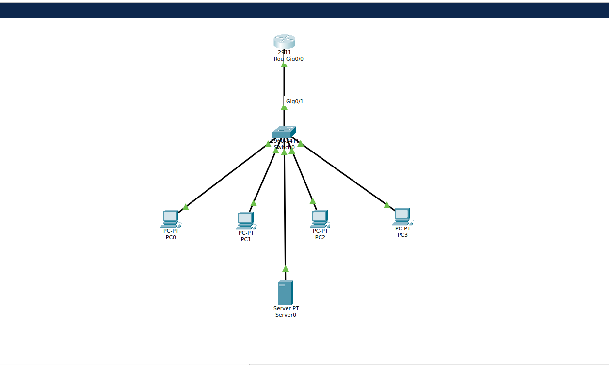

# Secure University Campus Network

## Project Documentation --- Phase 1 and Phase 2

**Project type:** Cisco Packet Tracer networking and cybersecurity lab\
**Environment:** Cisco Packet Tracer\
**Document version:** 1.0

------------------------------------------------------------------------

## 1. Project overview

The **Secure University Campus Network** project designs and implements
a segmented university network using Cisco Packet Tracer. The simulated
university has student devices, staff devices, and a university server.
The network will be developed in stages to demonstrate core networking
concepts and practical security controls.

The project aims to:

-   Build a working campus network topology.
-   Separate students and staff using Virtual LANs (VLANs).
-   Enable communication between approved networks through routing.
-   Provide services such as DHCP and DNS.
-   Restrict unauthorized traffic using Access Control Lists (ACLs).
-   Secure network-device administration using local authentication and
    SSH.
-   Test connectivity and security controls and document the results.

This is a simulation and learning project. Packet Tracer represents
network devices and their behavior; it is not a replacement for testing
on production equipment.

## 2. Planned network design

The planned logical design is:

``` text
                  Internet / ISP (simulated)
                            |
                     Edge Router (R1)
                            |
                     Core Switch (SW1)
                     /      |       \
              Student PCs Staff PCs University Server
                VLAN 10    VLAN 20    Server network
```

The initial departmental addressing plan is:

  -----------------------------------------------------------------------
  Network                 Purpose                 Planned subnet
  ----------------------- ----------------------- -----------------------
  VLAN 10                 Students                `192.168.10.0/24`

  VLAN 20                 Staff                   `192.168.20.0/24`

  VLAN 99                 Network management      To be defined
                          (planned)               

  Server network          University services     To be defined
                          (placement to be        
                          finalized)              
  -----------------------------------------------------------------------

The addressing plan is preliminary. IP addresses, gateways, server
placement, and VLAN configuration will be implemented and verified in
later phases.

## 3. Equipment and Packet Tracer devices

The initial topology uses these devices:

  ------------------------------------------------------------------------
  Device label     Packet Tracer                 Quantity Purpose
                   device                                 
  ---------------- ---------------- --------------------- ----------------
  R1               Cisco 2911                           1 Routing between
                   Router                                 networks

  SW1              Cisco 2960                           1 Connecting end
                   Switch                                 devices and VLAN
                                                          segmentation

  PC0--PC3         PC                                   4 Two student
                                                          endpoints and
                                                          two staff
                                                          endpoints

  Server0          Server                               1 University
                                                          network services
                                                          in a later phase
  ------------------------------------------------------------------------

### 3.1 How to add the devices

1.  Open Cisco Packet Tracer and create a new workspace.
2.  From **Network Devices → Routers**, select a **2911** router and
    place it on the workspace.
3.  From **Network Devices → Switches**, select a **2960** switch and
    place it below the router.
4.  From **End Devices**, add four PCs and one Server.
5.  Arrange the devices so the router is above the switch and the end
    devices are below it.
6.  Keep the device labels visible. The labels used in this project are
    `R1`, `SW1`, `PC0`, `PC1`, `PC2`, `PC3`, and `Server0`.

### 3.2 Physical cabling

Select **Connections** (the lightning-bolt icon), then choose **Copper
Straight-Through**.

Connect the devices as follows:

  From device   Interface            To device   Interface
  ------------- -------------------- ----------- --------------------
  R1            GigabitEthernet0/0   SW1         GigabitEthernet0/1
  PC0           FastEthernet0        SW1         FastEthernet0/1
  PC1           FastEthernet0        SW1         FastEthernet0/2
  PC2           FastEthernet0        SW1         FastEthernet0/3
  PC3           FastEthernet0        SW1         FastEthernet0/4
  Server0       FastEthernet0        SW1         FastEthernet0/5

Wait for link indicators to settle. A connected endpoint should normally
show an active link after the relevant interfaces have come up.

### 3.3 Save the Packet Tracer project

Save the Packet Tracer workspace as:

``` text
Secure-University-Network.pkt
```


------------------------------------------------------------------------

# Phase 1 --- Physical topology

## 4. Phase 1 objective

The objective of Phase 1 was to create the physical/logical device
layout and connect the router, switch, PCs, and server.

## 5. Phase 1 implementation

The following devices were added:

-   One Cisco 2911 router (`R1`).
-   One Cisco 2960 switch (`SW1`).
-   Four PCs (`PC0`--`PC3`).
-   One server (`Server0`).

The devices were connected using copper straight-through cables
according to the cabling table in Section 3.2.

### 5.1 Endpoint roles

  Device    Planned role            Switch port
  --------- ----------------------- -------------
  PC0       Student workstation 1   Fa0/1
  PC1       Student workstation 2   Fa0/2
  PC2       Staff workstation 1     Fa0/3
  PC3       Staff workstation 2     Fa0/4
  Server0   University server       Fa0/5

At this stage, the PCs and server are physically connected but have not
yet been assigned their departmental VLANs or configured IP addresses.

## 6. Phase 1 outcome

**Status: Completed.**

The physical topology was created successfully. The devices and their
cable connections form the base for the configuration work in Phase 2.




------------------------------------------------------------------------

# Phase 2 --- Router and switch configuration

## 7. Phase 2 objectives

Phase 2 prepares the network devices for later implementation. The
objectives are to:

1.  Set meaningful hostnames.
2.  Configure privileged and console authentication.
3.  Apply basic password protection.
4.  Display an administrative warning banner.
5.  Disable unwanted DNS lookup delays on the router.
6.  Configure SSH-based remote administration on the switch.
7.  Add descriptions to connected interfaces.
8.  Save and inspect the device configurations.

> **Security note:** The passwords shown below are demonstration
> credentials used in this Packet Tracer lab. Do not reuse them on real
> systems. Use unique, strong credentials in production. The
> `service password-encryption` command provides only weak reversible
> obfuscation for supported plaintext passwords; it is not strong
> encryption.

## 8. Configure router R1

Open the router, select the **CLI** tab, and press Enter if prompted.

### 8.1 Enter privileged EXEC mode

``` cisco
enable
```

The prompt changes from `Router>` to `Router#`.

### 8.2 Enter global configuration mode

``` cisco
configure terminal
```

Shortcut:

``` cisco
conf t
```

The prompt changes to `Router(config)#`.

### 8.3 Set the hostname

``` cisco
hostname R1
```

The hostname identifies the device in the CLI and in network
administration.

### 8.4 Configure basic password protection

``` cisco
enable secret Campus@2026
service password-encryption
security passwords min-length 10
```

-   `enable secret` sets the password required to enter privileged EXEC
    mode. IOS stores this using a stronger secret-hashing mechanism than
    the legacy `enable password` command.
-   `service password-encryption` obfuscates supported plaintext
    passwords in the configuration.
-   `security passwords min-length 10` requests a minimum password
    length of ten characters. Support can vary by simulated IOS version.

### 8.5 Configure console access

``` cisco
line console 0
password Console@2026
login
logging synchronous
exit
```

-   `line console 0` selects the console line.
-   `password` sets its line password.
-   `login` tells IOS to request that password.
-   `logging synchronous` keeps asynchronous system messages from
    disrupting command entry.

### 8.6 Configure a Message of the Day banner

``` cisco
banner motd #WARNING: Authorized University Network Administrators Only!#
```

The banner displays an access warning when someone connects to the
device.

### 8.7 Disable DNS lookup for mistyped commands

``` cisco
no ip domain-lookup
```

This prevents IOS from trying to resolve an unrecognized command as a
hostname, which can otherwise cause a delay.

### 8.8 Configure the router-to-switch interface

``` cisco
interface gigabitEthernet 0/0
description CONNECTION_TO_SW1
no shutdown
exit
```

-   `interface gigabitEthernet 0/0` enters the interface configuration
    context.
-   `description` documents the interface's purpose.
-   `no shutdown` administratively enables the interface.

No IP address is assigned yet. IP addressing and routing are planned for
later phases.

### 8.9 Save the router configuration

``` cisco
end
copy running-config startup-config
```

Press Enter if IOS asks to confirm the destination filename.

The running configuration is the active configuration in memory. The
startup configuration is used when the device reloads.

## 9. Configure switch SW1

Open the switch, select **CLI**, and press Enter if prompted.

### 9.1 Enter configuration mode and set the hostname

``` cisco
enable
configure terminal
hostname SW1
```

### 9.2 Configure basic password protection

``` cisco
enable secret Campus@2026
service password-encryption
```

The switch now has a privileged-mode secret and basic obfuscation
enabled for supported plaintext passwords.

### 9.3 Create a local administrator account

``` cisco
username netadmin privilege 15 secret Admin@2026
```

This creates a local account named `netadmin` with privilege level 15.
The `secret` keyword stores the credential as a secret rather than as a
plain line password.

### 9.4 Configure console access

``` cisco
line console 0
password Console@2026
login
logging synchronous
exit
```

This configures password-based console access and makes CLI output
easier to work with.

### 9.5 Configure SSH prerequisites

Set a domain name:

``` cisco
ip domain-name campus.local
```

Generate an RSA key pair:

``` cisco
crypto key generate rsa
```

When prompted for the modulus size, use 2048 bits if supported by the
Packet Tracer IOS image. If the simulator only supports a smaller size,
record that limitation and use the strongest supported option for this
lab.

Enable SSH version 2:

``` cisco
ip ssh version 2
```

### 9.6 Restrict remote VTY access to SSH

``` cisco
line vty 0 15
login local
transport input ssh
exit
```

-   `line vty 0 15` selects the virtual terminal lines used for remote
    CLI sessions.
-   `login local` authenticates users against the local username
    database.
-   `transport input ssh` permits SSH and excludes Telnet on these
    lines.

**Important:** SSH also requires a reachable IP address on the switch.
The management VLAN interface and its IP address will be configured in a
later phase. Therefore, these commands prepare SSH, but remote SSH
connectivity is not yet fully testable.

### 9.7 Configure the switch warning banner

``` cisco
banner motd #WARNING: Authorized University Network Administrators Only!#
```

### 9.8 Configure the router uplink description

``` cisco
interface gigabitEthernet 0/1
description CONNECTION_TO_R1
no shutdown
exit
```

The switch's GigabitEthernet0/1 port is intended to connect to R1's
GigabitEthernet0/0.

### 9.9 Add descriptions to endpoint ports

``` cisco
interface fastEthernet 0/1
description STUDENT_PC_01
exit

interface fastEthernet 0/2
description STUDENT_PC_02
exit

interface fastEthernet 0/3
description STAFF_PC_01
exit

interface fastEthernet 0/4
description STAFF_PC_02
exit

interface fastEthernet 0/5
description UNIVERSITY_SERVER
exit
```

These descriptions make it easier to identify which endpoint is
connected to each switch port.

### 9.10 Save the switch configuration

``` cisco
end
copy running-config startup-config
```

Press Enter if asked to confirm the destination filename.

------------------------------------------------------------------------

## 10. Phase 2 verification and observed results

The following commands were used to inspect the router and switch.

### 10.1 Router interface status

Command:

``` cisco
show ip interface brief
```

Observed output:

``` text
Interface              IP-Address      OK? Method Status                Protocol

GigabitEthernet0/0     unassigned      YES unset  up                    up
GigabitEthernet0/1     unassigned      YES unset  administratively down down
GigabitEthernet0/2     unassigned      YES unset  administratively down down
Vlan1                  unassigned      YES unset  administratively down down
```

Interpretation:

-   `GigabitEthernet0/0` is **up/up**, which confirms that the router
    interface is enabled and its physical/link protocol state is active.
-   The interface has no IP address yet. This is expected at this stage
    because IP addressing has not been configured.
-   `GigabitEthernet0/1` and `GigabitEthernet0/2` are unused and
    administratively down.
-   `Vlan1` is not being used as a router interface in the current
    design.

### 10.2 Switch port status

Command:

``` cisco
show interfaces status
```

Observed output:

``` text
Port      Name               Status       Vlan       Duplex  Speed Type

Fa0/1     STUDENT_PC_01      connected    1          a-full  a-100 10/100BaseTX
Fa0/2     STUDENT_PC_02      connected    1          a-full  a-100 10/100BaseTX
Fa0/3     STAFF_PC_01        connected    1          a-full  a-100 10/100BaseTX
Fa0/4     STAFF_PC_02        connected    1          a-full  a-100 10/100BaseTX
Fa0/5     UNIVERSITY_SERVER  connected    1          a-full  a-100 10/100BaseTX
Fa0/6                        notconnect   1          auto    auto  10/100BaseTX
```

Interpretation:

-   Fa0/1 through Fa0/5 are connected.
-   Their descriptions match the intended endpoint roles.
-   All displayed ports are currently assigned to the default VLAN 1.
    This is expected before Phase 3.
-   Fa0/6 is unused and shows `notconnect`.
-   The supplied output does not show the GigabitEthernet0/1 uplink row.
    Verify that interface separately before treating the switch uplink
    as fully confirmed.

Useful additional verification commands:

``` cisco
show interfaces gigabitEthernet 0/1 status
show interfaces gigabitEthernet 0/1
show vlan brief
show running-config
show ip ssh
```

If the switch's GigabitEthernet0/1 port does not show an active link,
check that the cable is connected to R1's GigabitEthernet0/0 and that
both ends are enabled.

## 11. Phase 2 completion status

  -----------------------------------------------------------------------
  Check                               Result
  ----------------------------------- -----------------------------------
  Router hostname configured          Completed

  Router basic security configured    Configuration commands applied

  Router G0/0 enabled                 Verified up/up

  Switch hostname configured          Completed

  Switch basic security configured    Configuration commands applied

  Local switch administrator created  Configuration command applied

  SSH prerequisites and VTY settings  Configuration commands applied;
  configured                          remote access awaits management IP

  Endpoint port descriptions          Visible in switch output
  configured                          

  PC and server ports connected       Verified Fa0/1--Fa0/5

  Router/switch uplink                Router side verified up/up;
                                      switch-side output still to be
                                      checked

  Configurations saved                Save commands issued; verify
                                      startup configuration if needed
  -----------------------------------------------------------------------

### 11.1 Important security and implementation notes

-   Passwords in this document are lab examples, not production
    credentials.
-   `service password-encryption` is not a substitute for strong secret
    storage or secure authentication.
-   SSH remote administration is not complete until the switch has a
    reachable management IP address and an SSH connection is tested.
-   The current network is still using the default VLAN 1 on the
    displayed switch ports. Departmental segmentation has not yet been
    implemented.
-   No IP addressing, DHCP, DNS, ACLs, or internet simulation has been
    configured yet.

------------------------------------------------------------------------

# 12. Phase 3 --- VLAN configuration

Phase 3 will introduce network segmentation.

The planned VLANs are:

    VLAN ID Name         Intended devices
  --------- ------------ -------------------------------------
         10 STUDENTS     PC0 and PC1
         20 STAFF        PC2 and PC3
         99 MANAGEMENT   Network-device management (planned)

We will create the VLANs, assign the correct access ports, and configure
the router-switch link as a trunk where appropriate. We will then verify
VLAN membership before moving to inter-VLAN routing.

## 13. Project file structure

Suggested directory structure:

``` text
Secure-University-Network/
├── Secure-University-Network.pkt
└── documentation/
    ├── phase-1-and-2.md
    ├── topology/
    ├── screenshots/
    └── test-results/
```

Add screenshots of the completed topology, device configurations, and
verification outputs to the relevant folders as the project progresses.

## 14. Learning outcomes so far

By completing Phases 1 and 2, the project has introduced:

-   Basic campus network topology design.
-   Cisco Packet Tracer device selection and cabling.
-   Router and switch CLI navigation.
-   Cisco IOS user EXEC, privileged EXEC, and global configuration
    modes.
-   Device hostnames and interface descriptions.
-   Console and privileged-mode password configuration.
-   Local user creation.
-   SSH configuration prerequisites and VTY restrictions.
-   Interface activation and status verification.
-   Saving running configurations to startup configurations.

